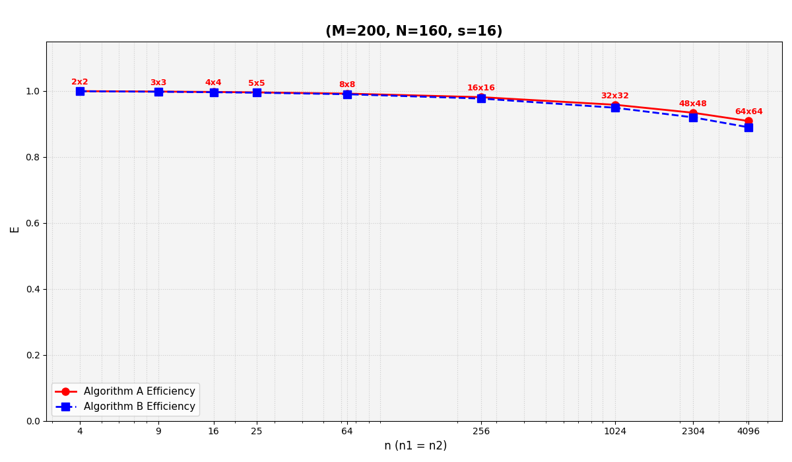
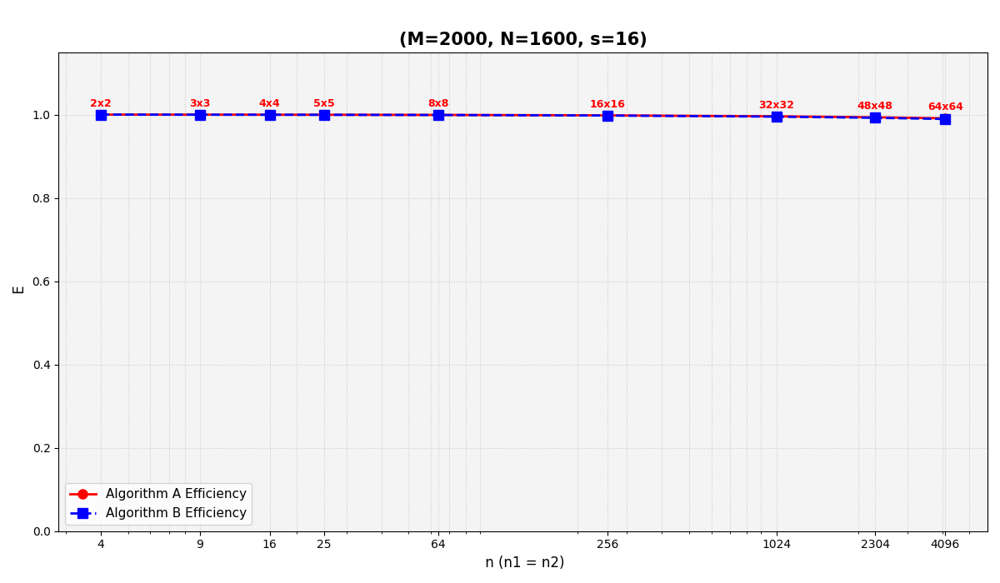
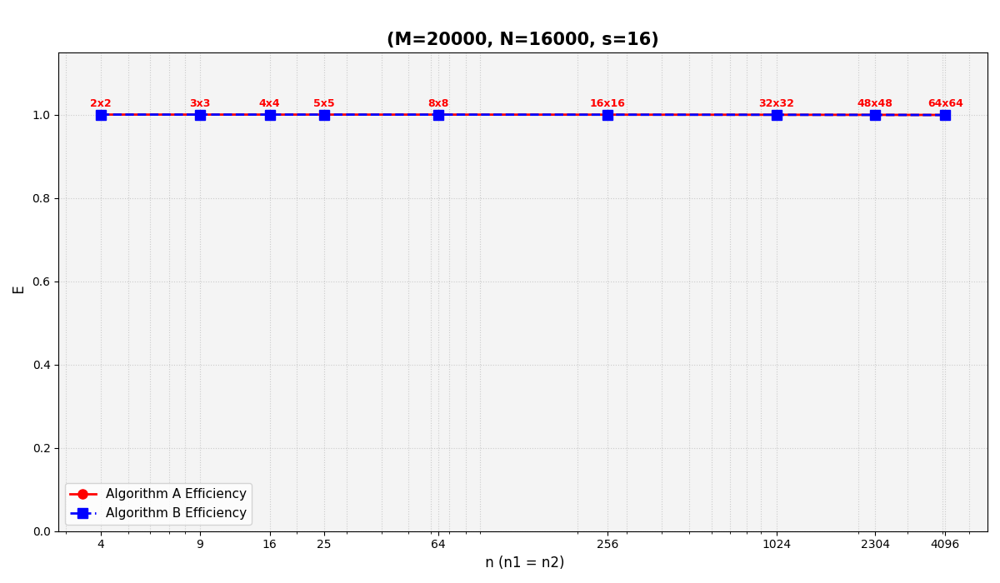

# Numerical Inverse Problems · MPI Parallel Computing · Preconditioned Solvers

**LI WEIZHI** · M.Sc. student, Faculty of Physics (mathematics research group), Lomonosov Moscow State University  
**Research-code portfolio for PhD applications (2027)** · Python · NumPy · mpi4py · iterative methods

> **My contribution:** I translated established numerical algorithms into executable programs, adapted the formulations used in my master's work, developed MPI parallel implementations, and produced my own numerical comparisons and research presentation. My contribution is **algorithm adaptation, implementation, parallelization and analysis**, not invention of the original CG or cross-approximation methods.

This repository collects both **completed research implementations** and a clearly marked **ongoing preconditioned-CG research direction**. It is a research portfolio rather than a production-grade numerical library.

## Featured research

| Topic | What I implemented or analyzed | Location | Status |
| --- | --- | --- | --- |
| **Two MPI-parallel CG-type variants** | Python algorithms, 2-D Cartesian process grid, block-distributed matrix operations, global reductions | [`mpi/`](mpi/) | Research code; MPI rerun required on a configured cluster |
| **Persistent collective communication** | Reusable `MPI.Allreduce_init` requests, `Start()`/`Wait()` in the iterative computation; other variants use `Iallreduce` | [`mpi/cg_2d_variant_1.py`](mpi/cg_2d_variant_1.py), [`mpi/cg_2d_variant_2.py`](mpi/cg_2d_variant_2.py) | **Implemented optimization mechanism**; isolated runtime benefit not yet benchmarked here |
| **Cost-model efficiency comparison** | Adapted arithmetic/communication cost models for two algorithm formulations; generated three 2026 comparisons and research conclusions | [`performance/`](performance/), [`figures/may_2026_efficiency/`](figures/may_2026_efficiency/) | Completed **model-based numerical analysis** |
| **MPI cross approximation** | Distributed dense-matrix blocks, residual pivot search, broadcast of low-rank factors | [`mpi/parallel_cross_approximation.py`](mpi/parallel_cross_approximation.py) | Experimental prototype |
| **Preconditioned regularized CGNR (λ-PCG / PCGNR)** | Low-rank cross approximation → QR/SVD recompression → preconditioner for a 1-D inverse model | [`notebooks/preconditioned_cgnr_inverse.ipynb`](notebooks/preconditioned_cgnr_inverse.ipynb) | Existing serial proof of concept; **PCGR work is ongoing** |
| **Polynomial-parameterized inverse reconstruction** | Polynomial approximation and optimization for an inverse model | [`notebooks/polynomial_expansion_inverse.ipynb`](notebooks/polynomial_expansion_inverse.ipynb) | Numerical notebook |
| **Earlier serial / distributed experiments** | Initial CG implementation and communication approaches | [`legacy/`](legacy/) | Archived; some input data not included |
| **Nesterov-accelerated iterative reconstruction (earlier work)** | Earlier exploration of accelerated iterations and discrepancy stopping | *Not included: source not among current uploads* | Prior research; not claimed as verifiable code in this repository |

### Current research: PCGR / preconditioned conjugate-gradient methods

My current work explores **regularization and preconditioning for conjugate-gradient-type solvers** of discretized inverse problems, including low-rank structure obtained by cross approximation and QR/SVD factor recompression. The provided notebook is labeled **λ-PCG** and implements a **regularized preconditioned CGNR variant** (`rCGNR`). The current **PCGR research direction** is **ongoing**: the repository does **not** claim a completed, separately verified MPI-PCGR implementation.

For the **specific synthetic model and stopping criterion** saved in the notebook, the output reports a retained preconditioner rank of **16**, **1 iteration** for PCGNR and **14 iterations** for the unpreconditioned CGNR version. These numbers do not establish general speedup or equivalence of runtime because preconditioner construction incurs additional work.

## Original May 2026 efficiency results

The three charts below were generated by me during my master's research, and supplied with this portfolio. They compare two CG-type algorithm formulations using a **parameterized computational/communication cost model** under square MPI process-grid assumptions. The plotted values are **my numerical model results, not directly measured wall-clock timings from MPI runs**.

| Model matrix size | Algorithm A at 64×64 grid | Algorithm B at 64×64 grid |
| --- | ---: | ---: |
| 200 × 160 | 90.84% | 88.94% |
| 2,000 × 1,600 | 99.11% | 98.94% |
| 20,000 × 16,000 | 99.91% | 99.89% |

Parameters used in [`performance/efficiency_by_process_count.py`](performance/efficiency_by_process_count.py): 16 iterations, `C1=1e-9`, `C1_tilde=1e-8`, `C2=1e-10`. The table values are rounded from a direct evaluation of the supplied cost formulas. For the analyzed parameter regime, both formulations show similar **predicted** efficiency, while the larger matrix cases display less relative modeled communication overhead. These are **not** a hardware benchmark and must not be used as claims of measured HPC speedup.





Reproduce the numerical table and model-generated figures with:

```bash
python -m pip install -r requirements.txt
python performance/reproduce_may2026_plots.py
```

The new reproducibility script recomputes the model formula and creates new graph files; **the images above are the original uploaded figures**, not regenerated replacements.

## My previous research presentation

- [May 13, 2026 seminar slides (Russian, 31 pages)](presentations/2026-05-13_cg_hpc_seminar_ru.pdf) — presentation of two formulations, cost models, comparisons and conclusions.
- [English research report (PDF)](reports/Research_Portfolio_LI_WEIZHI_EN.pdf) · [Chinese research report (PDF)](reports/科研工作总结_李伟志_CN.pdf)
- [Personal contributions](CONTRIBUTIONS.md) · [Evidence and status](docs/EVIDENCE_AND_STATUS.md)

The 2026 slides use regularization-related terms in the mathematical formulations. The provided `mpi/` scripts are CG-type research implementations and **should not be assumed to be exact code equivalents of every equation on the slides**. The reference manuscript on which the analysis built is not included here because its distribution status was not established.

## Code map

```text
mpi/
  cg_2d_variant_1.py               # 2-D MPI CG-type implementation; persistent requests
  cg_2d_variant_2.py               # alternative 2-D MPI CG-type implementation
  parallel_cross_approximation.py  # parallel cross-approximation prototype
performance/
  efficiency_by_process_count.py   # original E2.py, renamed
  efficiency_by_topology.py        # original E.py, renamed
  reproduce_may2026_plots.py       # added reproducibility helper
  data/may2026_modeled_efficiency.csv
notebooks/
  preconditioned_cgnr_inverse.ipynb
  polynomial_expansion_inverse.ipynb
figures/
  may_2026_efficiency/             # 3 user-supplied original plots
  ...                              # notebook figures
presentations/
  2026-05-13_cg_hpc_seminar_ru.pdf
reports/
  Research_Portfolio_LI_WEIZHI_EN.pdf
  科研工作总结_李伟志_CN.pdf
legacy/
  cg_1d_experiment.py
  cg_distributed_experiment.py
```

## Execution notes

- Python 3, NumPy, SciPy, Matplotlib, Jupyter; a working MPI runtime and `mpi4py` for parallel code.
- Research MPI prototypes assume a **square process grid**: try 4 or 9 processes after installation, e.g. `mpiexec -n 4 python mpi/cg_2d_variant_1.py`.
- The 2-D scripts call `Allreduce_init`, which requires an MPI implementation/`mpi4py` version supporting MPI-4 persistent collectives.
- The archived legacy scripts require unavailable input files (`in.dat`, `AData.dat`, `bData.dat`).
- The Jupyter notebook reports are numerical examples, not universal performance guarantees.
- **Packaging verification**: Python source parsed successfully; MPI code not run in this environment. Numerical performance gains from persistent collectives have **not** been isolated by a controlled timing comparison in these materials.

See [reproducibility notes](docs/REPRODUCIBILITY.md) and [technical claim mapping](docs/EVIDENCE_AND_STATUS.md) for limitations and provenance.

**Publication note:** Before making this repository public, check any research-group distribution constraints and verify that contact details in the presentation may be publicly posted. No peer-reviewed publication is claimed.
