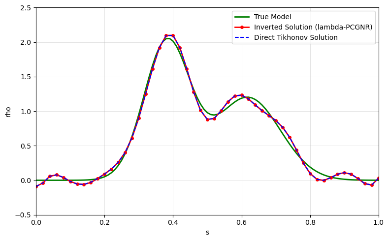
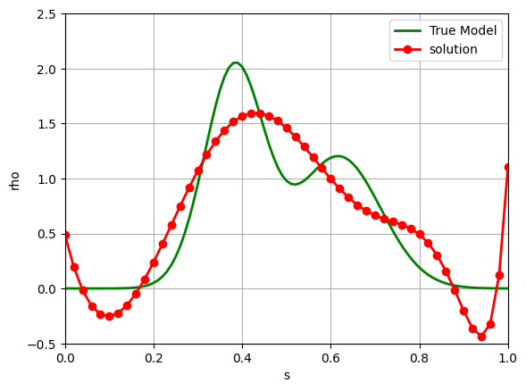

# Numerical Inverse Problems and High-Performance Computing

**Research implementation portfolio — LI WEIZHI**  
Lomonosov Moscow State University · Faculty of Physics, Department of Mathematics

**Research interests:** numerical linear algebra · inverse problems · iterative solvers · MPI parallel computing · high-performance scientific computing

## Overview

My main contribution in the projects collected here has been to **translate mathematical algorithms and pseudocode into Python implementations and develop their MPI-parallel versions**. The core tasks include implementing iterative numerical methods, distributing matrix and vector data among MPI processes, organizing inter-process communication, and comparing implementations through numerical experiments and analytical efficiency models.

These projects were developed during my master's research at Lomonosov Moscow State University. I used an existing research manuscript as a reference, **adapted the algorithmic formulations to the variants used in my work**, implemented them in Python and MPI, and **performed my own comparison and drew my own conclusions**. I do not claim to have invented conjugate-gradient methods, cross approximation or the entire original research framework.

> **Implementation status:** Research prototypes, not production software. Both included Jupyter notebooks completed a re-execution check while organizing the portfolio. MPI scripts were inspected but **not executed** in the packaging environment, which lacks MPI. The efficiency plots are **model-based predictions**, not measured wall-clock speedups.

## Featured work

| Topic | Code | Main implementation work |
| --- | --- | --- |
| **MPI parallelization of conjugate-gradient-type methods** | [`mpi/cg_2d_variant_1.py`](mpi/cg_2d_variant_1.py), [`mpi/cg_2d_variant_2.py`](mpi/cg_2d_variant_2.py) | Python implementations of two CG-type numerical schemes, distributed dense matrix blocks, 2-D Cartesian process grids, row/column communicators and MPI reductions |
| **Parallel cross approximation** | [`mpi/parallel_cross_approximation.py`](mpi/parallel_cross_approximation.py) | Experimental MPI implementation using distributed matrix blocks, pivot selection and incremental low-rank factors |
| **Communication-aware efficiency comparison** | [`performance/efficiency_by_topology.py`](performance/efficiency_by_topology.py), [`performance/efficiency_by_process_count.py`](performance/efficiency_by_process_count.py) | Adapted the performance-analysis framework to my chosen algorithm variants, wrote Python scripts to evaluate the resulting analytical cost expressions, and generated my own efficiency comparisons and conclusions |
| **Iterative inverse-problem experiments** | [`notebooks/preconditioned_cgnr_inverse.ipynb`](notebooks/preconditioned_cgnr_inverse.ipynb) | Numerical tests involving CGNR, approximate low-rank preconditioning, QR/SVD recompression, and a one-dimensional inverse model |
| **Polynomial approximation experiment** | [`notebooks/polynomial_expansion_inverse.ipynb`](notebooks/polynomial_expansion_inverse.ipynb) | Python experiment for a polynomial-parameterized one-dimensional inverse model |
| **Earlier exploratory scripts** | [`legacy/`](legacy/) | Preliminary serial/distributed CG experiments requiring external input files; archived, not self-contained demos |

## Previous research presentation — May 13, 2026

My Russian-language master's seminar presentation, *High-performance implementations of the conjugate gradient method for ill-posed linear inverse problems*, is available here:

- **[Presentation slides (Russian, PDF)](presentations/2026-05-13_cg_hpc_seminar_ru.pdf)** — original slides attributed to LI WEIZHI, Moscow, May 13, 2026.
- **[English research implementation summary](docs/RESEARCH_SUMMARY.md)** — concise description of the task, implementation focus and limitations.

The talk considers two conjugate-gradient-type formulations for systems arising from linear inverse problems. I adapted the algorithm descriptions and comparison to the variants used in my work. The slides discuss floating-point considerations, communication costs and parallel efficiency, and present **my computational comparisons and conclusion**: for the investigated configurations the two variants have similar estimated efficiency. The included `performance/` scripts evaluate an analytical cost model, so their curves are **independently computed results, but not direct measurements of MPI wall-clock runtime**.

## Numerical setting

We consider discretized linear inverse problems, typically written as

$$A x \approx b_\delta,$$

where $b_\delta$ is perturbed observation data and $A$ is the discretized forward operator. The parallel implementations focus on distributing the relevant matrix-vector and vector operations across a two-dimensional MPI process grid, including communication of partial products and reductions.

The presentation uses the standard notions of speedup and parallel efficiency:

$$S_p=\frac{T_1}{T_p},\qquad E_p=\frac{S_p}{p},$$

with $T_1$ the serial execution time and $T_p$ the time on $p$ processes. Scripts under `performance/` estimate efficiency **from a parameterized cost model**; they do not measure $T_p$ from actual MPI runs.

## Saved notebook outputs





## Requirements and how to run

- Python 3, NumPy, SciPy, Matplotlib, Jupyter
- MPI implementation such as Open MPI or MPICH, plus `mpi4py`, for MPI experiments

```bash
python -m pip install -r requirements.txt
python performance/efficiency_by_topology.py
python performance/efficiency_by_process_count.py
jupyter notebook notebooks/preconditioned_cgnr_inverse.ipynb
```

For the current MPI prototypes, use a **perfect-square** number of processes, for example:

```bash
mpiexec -n 4 python mpi/cg_2d_variant_1.py
mpiexec -n 4 python mpi/cg_2d_variant_2.py
mpiexec -n 4 python mpi/parallel_cross_approximation.py
```

These commands are *starting points for verification*, not a claim that every variant has already passed an MPI end-to-end test. Older code in `legacy/` additionally requires `in.dat`, `AData.dat` and `bData.dat`, which are not supplied.

## My role and reproducibility

- **[Personal contributions](CONTRIBUTIONS.md)** — precise scope of my implementation work and attribution boundaries
- **[Research summary (English)](docs/RESEARCH_SUMMARY.md)** — a short explanation suitable for prospective research supervisors
- **[Reproducibility notes](docs/REPRODUCIBILITY.md)** — current limitations and checks still needed

The original algorithmic ideas are not claimed as novel contributions. The separate background/theory manuscript supplied during preparation is not included because its authorship and permission to distribute have not been established. The seminar slides are my attributed presentation and should also be reviewed for any sharing restrictions before the repository is made public.
